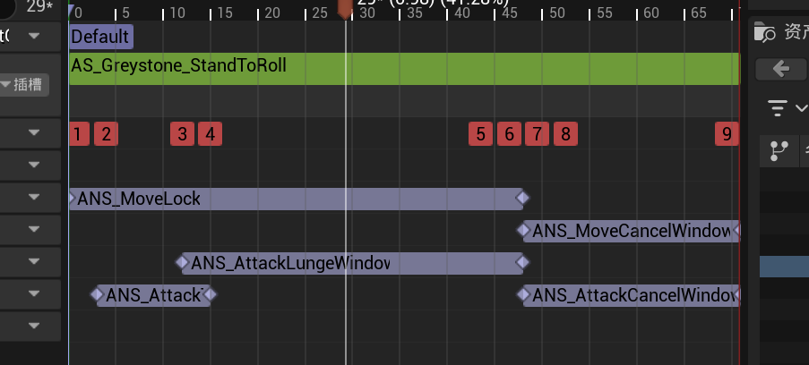
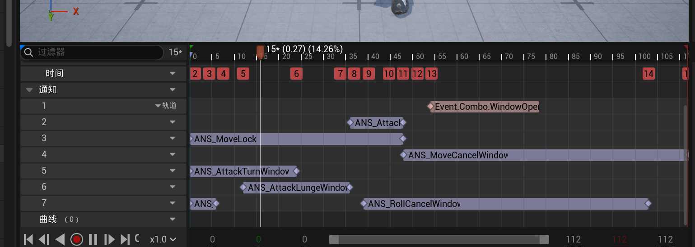

# 行动日志 06 · 翻滚动画导入与重定向

日期：2026-10-18。用户明确授权 AI 导入并重定向动画。

## 当前结果

用户因攻击滑步影响手感，已自行关闭攻击前进位移；不要自动恢复。

用户提供 `C:/Users/10645/Downloads/Stand To Roll.fbx`。检查确认是 Mixamo 导出的 FBX 7700，65 根骨骼，动画时长约 2.3667 秒，无模型，顶层骨骼为 Hips，没有独立地面 root。

为支持 UE 的 IK 重定向，使用脚本给源文件添加每骨骼四顶点的简易蒙皮预览模型。保留原始骨骼、参考变换、动画与连接，不修改下载的原文件。该模型仅供导入与重定向，不是游戏角色。

资产位于 `/Game/Gameplay/Anims/Roll`：

- `AS_Greystone_StandToRoll`：Greystone 骨架的翻滚动画，开启根运动。
- `IK_MixamoRoll`、`IK_GreystoneRoll`：两侧 IK Rig，使用 UE 5.8 自动生成人形链。
- `RTG_Mixamo_Greystone_Roll`：重定向器，目标骨骼自动对齐。
- `Source/AS_Mixamo_StandToRoll`：原动作。
- `Source/SK_MixamoRollPreview` 及对应 Skeleton：简易源预览模型与骨架。

## 根运动处理

默认 Root Motion 操作会把 Hips 的运动当作源 root，导致根骨骼随髋部升降、旋转。改为从目标 pelvis 生成运动，目标 root 固定 Z=0，不随 pelvis 旋转，关闭 Maintain Offset From Pelvis，避免参考姿势的髋部偏移在翻滚时旋转成额外水平摆动。此功能来自引擎 `RootMotionGeneratorOp.h/.cpp` 的现有 API。

抽样结果：目标根骨骼水平前进约 466 cm，9 个采样点的 Z 均为 0；pelvis 保留下降、翻转与起身动作。时长与原动画一致。实际翻滚距离、播放速度尚未调手感。

## 验证边界

- 后台虚幻编辑器完成 FBX 导入、重定向和资产保存。
- 多帧姿势采样确认目标使用 Greystone Skeleton、姿势随时间变化、坐标有限，根运动开启且贴地。
- 未完成编辑器内模型视觉验收：仍须检查持剑盾穿插、贴地、姿势和衔接。
- 尚未创建翻滚 GA、蒙太奇、输入、体力成本、无敌帧与取消规则；没有修改现有攻击和移动逻辑。
- 本次未提交或推送。Roll 包含第三方动作数据，未复制到公开 GitHub 自有资产快照；发布源文件前需核对该素材的再分发许可。

## 复现工具

按顺序执行 `Tools/prepare_roll_source.py`（引擎自带 Python）、`Tools/import_retarget_roll.py`（UE Python）、`Tools/finalize_roll_root_motion.py`（UE Python）。最后一个脚本调用 `Tools/verify_roll_retarget.py` 做姿势采样。结果和日志在 `Saved/RollImport`。

下一步：在内容浏览器播放 `AS_Greystone_StandToRoll`，确认视觉效果后制作翻滚蒙太奇与 GA。

## 后续接入与插槽排错（同日）

用户预览后认为动画可用，并自行创建 `AM_Roll`、`GA_Roll` 和 `IA_Roll`，按键采用左 Shift。用户暂时关闭翻滚序列根运动、开启强制根锁定，以测试原地动作；动画蓝图 Root Motion Mode 尚未设置。以上是后续状态，覆盖前文“尚未创建”的阶段记录。

用户报告按键不播放。只读检查保存资产：左 Shift 映射正确、角色初始技能列表已加入 GA_Roll、技能标签为 Ability.Roll。明确发现 AM_Roll 使用 DefaultSlot，而现有正常攻击蒙太奇使用 UpperBody。已指导把 AM_Roll 改为 UpperBody，修改后的播放结果待验证。用户要求将复发问题记入错题本，已扩充 P22，不重复另建编号。

下一步先确认插槽修正后的原地播放，再接方向、实际位移、体力和无敌帧。

## 输入修复、翻滚可用与取消规则定案（同日后续）

插槽修正后仍未进入 GA_Roll，用户最终定位为 BP 中 `AbilityRoll` 变量默认值为空；填入 Ability.Roll 后用户确认成功。插槽不匹配和激活标签变量为空是两个独立问题。之后用户确认有一个基本可用的翻滚，并已配置移动打断翻滚。截图显示 AM_Roll 上有 ANS_MoveLock、ANS_MoveCancelWindow 和 ANS_AttackLungeWindow；不可据此宣称当前运行位移由根运动驱动。

用户提供 22.23 秒录像，已在本地每秒抽取 2 帧查看。可观察角色翻滚、攻击和移动，录像没有按键显示，不能据此精确判断按键时刻或吞输入帧数。

用户明确决定：攻击与翻滚的相互衔接由动画通知/时间窗口决定，不采用整个 State.Attacking 生命周期禁止翻滚、或整个 GA_Roll 生命周期禁止攻击。此前教程中的粗粒度阻止配置仅为初步接通流程，后续必须替换。此项是设计定案，尚未实现。

计划：攻击 Montage 的 RollCancelWindow 允许翻滚取消攻击后摇；翻滚 Montage 的 AttackCancelWindow 允许攻击取消翻滚后摇；移动继续使用现有 MoveCancelWindow。窗口各自可拖，不强制与 MoveLock 终点对齐。沿用蓝图 ANS + GE + 标签的现有模式；State.Attacking/State.Rolling 仅表示当前动作，窗口决定该动作能否被指定输入取消。技能输入不可统一被 IsMoveLocked 拦截，否则提前开放的技能取消窗口仍无效。攻击三连击自己的阻止矩阵不在此轮删除范围。

窗口切换与打断必须结束旧 GA，并清理旧通知窗口、移动锁、位移和武器判定；不可只停蒙太奇或同时执行多个动作。新技能激活失败时应保留旧动作，后续接入体力时必须复核取消与扣费的执行先后。短时输入缓存为后续手感候选项，尚未定案。

## 混出后的打断收尾修复（2026-10-19）

用户报告翻滚被攻击打断后偶发永久无法再次翻滚，ActivateAbility 前置打印不出现。运行时截图显示 Ability.Roll 的阻止计数为 1，Owned Tags 为空。查引擎 PlayMontageAndWait 源码定位到混出之后再被打断的退出路径：开启 Allow Interrupt After Blend Out，并保留 OnInterrupted → EndAbility。用户在 2026-10-19 确认问题已解决，记录为错题本 P32。

下一步制作 AM_Roll 的攻击取消窗口，前段保护翻滚、窗口内允许攻击。沿用 ANS_RollCancelWindow / GE_RollCancelWindow 的模式，新建 ANS_AttackCancelWindow / GE_AttackCancelWindow，标签 State.AttackCancelWindow。用 State.Rolling 仅标识当前翻滚生命周期，BP_Player 的攻击输入仅在正在翻滚时查询取消窗口；空闲时走原攻击链，不能把窗口设为所有攻击的永久激活必需条件。这是施工方案，尚未实现或验收。

## 收工基线（2026-10-19，覆盖前面的阶段性待办）

用户确认“完成了一个还行的翻滚版本”，授权保存、提交本地 Git 和同步 GitHub。编辑器已关闭，AM_Roll 最后保存时间约 01:05；以磁盘已保存资产归档，没有重新打开编辑器修改玩法。

只读最终复核确认：

- 左 Shift → IA_Roll，角色已授予 GA_Roll；AbilityRoll 空默认值问题已由用户修复（P33）。
- AM_Roll 引用 AS_Greystone_StandToRoll，UpperBody 插槽，Rate Scale=2。原序列约 2.3667 秒，正常完整播放约 1.18 秒，可被取消。
- 当前序列 Enable Root Motion=false、Force Root Lock=true；位移用 ANS_AttackLungeWindow，转向用 ANS_AttackTurnWindow。不要把导入阶段生成的根运动当作最终配置。
- 时间轴已有 MoveLock、MoveCancelWindow、AttackCancelWindow。GA_Roll 拥有 State.Rolling，仅阻止自身重入，不整段阻止攻击。
- BP_Player 在翻滚时正确查询 State.AttackCancelWindow；此前误查 RollCancelWindow 的问题记 P34。
- Allow Interrupt After Blend Out=true，混出后打断遗留旧技能的问题已由用户确认修复（P32）。
- 三段攻击各有两段 RollCancelWindow 通知（截图可见早段和后段），按用户调参结果保留；但当前翻滚输入只经过 IsFalling 检查后激活，没有消费该窗口。下次补齐前不能声称攻击→翻滚已按窗口限制。
- GA_Roll 的 Cost/Cooldown 均为空；无敌帧未接入。

验收由用户完成 PIE 手感确认；AI 只读核对保存资产，没有另做完整战斗回归，没有新 C++ 改动需要编译。

下次：先补攻击中翻滚窗口的输入判断，核对早段/后段窗口意图；再做翻滚体力、无敌帧、受击死亡。接入体力时检查新动作失败不能无故取消旧动作。

归档范围：完整已保存资产、动作序列和源预览骨架提交到 Content 本地 Git；公开 GitHub 保存自有玩法、输入、蒙太奇和重定向配置，Mixamo 动作数据与原始 FBX 保留本地。恢复流程见资产盘点文档。本轮另在 LocalBackups 保存原 FBX 和变更资产压缩包，该目录不进入公开仓库。

素材本地提交：`cca12f5`（feat: 保存翻滚第一版与动作取消窗口），共 21 个已保存资产变更。GitHub 快照共 192 文件，约 32.87 MiB；清单与 SHA-256 见 project-content-manifest.json。用户追加要求记录找动作和重定向的方法，已编写 [Mixamo 操作指南与三组复用提示词](../notes/mixamo-animation-workflow.md)，并加入 README / 主文档入口。
